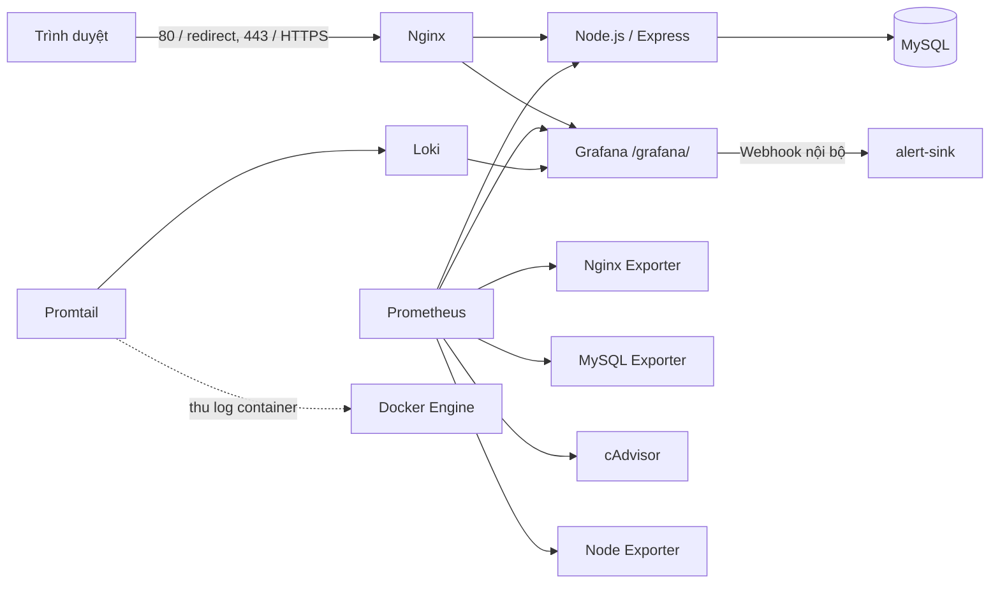

# Hệ thống Quản lý Câu lạc bộ

Ứng dụng web quản lý thành viên và hoạt động câu lạc bộ, đóng gói bằng Docker Compose. Repo hiện chứa cấu hình reverse proxy HTTPS, Prometheus/Grafana, Loki/Promtail và các biện pháp hardening. Cấu hình không đồng nghĩa với việc các kiểm tra runtime đã đạt; xem [docs/cho-bao-cao.md](./docs/cho-bao-cao.md) và thư mục evidence cục bộ để phân biệt rõ.

## Chức năng và vai trò

- **Thành viên:** đăng ký/đăng nhập, xem sự kiện và thông báo, đăng ký hoặc hủy đăng ký sự kiện, xem lịch sử điểm danh và cập nhật hồ sơ.
- **Officer:** dashboard, xem/quản lý trạng thái thành viên, tạo/sửa sự kiện, điểm danh và đăng thông báo.
- **Admin:** dashboard, phân quyền/kích hoạt tài khoản, quản lý nhóm và thành viên nhóm, quản lý thu/chi và xem audit log.

Một số thao tác có thể phụ thuộc dữ liệu mẫu hoặc trạng thái nghiệp vụ hiện có. Hãy kiểm thử trên môi trường dùng thử trước khi đưa vào vận hành.

## Kiến trúc



Các network Compose được chia thành `frontend`, `backend`, `monitoring` và `proxy_metrics`; `backend`, `monitoring` và `proxy_metrics` là internal. Nginx publish cổng host 80/443 theo mặc định; có thể đổi bằng `HOST_HTTP_PORT` và `HOST_HTTPS_PORT` trong `.env`. Để chạy thử trên chính máy Windows, Nginx cũng publish `http://localhost:3000` chỉ trên loopback; Prometheus UI được chuyển tiếp qua Nginx tại `http://127.0.0.1:9090/`, cũng chỉ trên loopback. Hai cổng này dùng HTTP, không mã hóa dữ liệu và không được dùng để truy cập từ máy khác hoặc triển khai công khai. Khi triển khai thật, dùng HTTPS qua cổng 443 và truy cập Prometheus qua SSH tunnel theo cấu hình mạng phù hợp. MySQL, Grafana, Loki và exporter không publish cổng host. Promtail cần Docker socket để discovery log; socket mount `:ro` vẫn có thể cho phép gọi API Docker và phải được xem là quyền rất nhạy cảm. Chi tiết ở [docs/hardening.md](./docs/hardening.md).

## Yêu cầu và phiên bản

- Linux VM có Docker Engine, Docker Compose plugin, Git, OpenSSL, `bash`, `curl` và quyền chạy Docker.
- Cần quyền truy cập VM/console để xác nhận listener, firewall và các kiểm tra hardening.
- Docker image được pin theo tag trong [docker-compose.yml](./docker-compose.yml) và [docs/phien-ban.md](./docs/phien-ban.md). Đây là tag cấu hình, không phải kết quả xác nhận các image đã chạy trên VM.
- Ở môi trường làm việc hiện tại Docker Engine không truy cập được; chưa có kiểm thử end-to-end. Không dùng hướng dẫn này như xác nhận triển khai đã thành công.

## Clone và khởi chạy

Thay `<OWNER>` bằng tên tài khoản/tổ chức sở hữu repo:

```sh
git clone https://github.com/<OWNER>/DTC245180162-club-management.git
cd DTC245180162-club-management
```

1. Tạo file môi trường từ mẫu, chỉ điền secret mới và không chia sẻ/commit `.env`:

   ```sh
   cp .env.example .env
   chmod 600 .env
   ```

   Tạo các giá trị ngẫu nhiên riêng cho `DB_ROOT_PASSWORD`, `DB_PASSWORD`, `DB_MONITOR_PASSWORD`, `SESSION_SECRET`, `GRAFANA_ADMIN_PASSWORD` và ba biến `*_INITIAL_PASSWORD`. Các mật khẩu DB cần theo định dạng trong `.env.example`/[docs/hardening.md](./docs/hardening.md); ba mật khẩu khởi tạo tài khoản phải dài ít nhất 14 ký tự. Trên Linux có thể dùng `sh scripts/prepare-env.sh` để tạo `.env` nếu chưa có và áp dụng mode `600`; script không tự sinh secret. Trên Windows, dùng WSL/Linux VM và bảo đảm quyền file tương đương.

2. Tạo chứng chỉ tự ký cho IPv4 của VM:

   ```sh
   sudo bash nginx/gen-cert.sh <VM_IP>
   ```

   Script tạo RSA 2048, thời hạn 365 ngày, CN là IP VM và SAN gồm IP VM, `localhost`, `127.0.0.1`. Private key và certificate nằm trong `nginx/certs/`, bị ignore bởi Git. Chứng chỉ tự ký gây cảnh báo trên trình duyệt cho đến khi được tin cậy; không dùng private key của repo làm chứng chỉ công khai.

3. Cấu hình login seed được áp dụng bởi service one-shot `db-seed-passwords` sau khi cấp quyền DB. `.env` chứa password khởi tạo riêng cho `admin`, `officer1`/`officer2`, và `member1`/`member2`/`member3`; tài khoản `locked_user` vẫn bị khóa. Job cập nhật password hash qua tài khoản ứng dụng, không ghi plaintext password vào log. Khi cần đổi lại password seed, cập nhật `.env`, xóa riêng container one-shot `club-db-seed-passwords` sau khi xác minh đúng tên, rồi chạy lại `docker compose up -d`; không xóa volume MySQL. Mật khẩu ứng dụng đang quản lý qua `.env` vì app hiện không có luồng đổi mật khẩu.

4. Khởi động:

   ```sh
   docker compose up -d --build
   docker compose ps
   ```

   Trên máy đang chạy Docker, mở `http://localhost:3000/` để thử ứng dụng qua HTTP nội bộ. Kết nối này chỉ bind loopback và không mã hóa, không dùng để gửi dữ liệu nhạy cảm qua mạng. Khi triển khai trên VM,    Trên máy local, mở ứng dụng tại `http://localhost:3000/` và Grafana tại `https://localhost:<HOST_HTTPS_PORT>/grafana/` (mặc định cổng 443). Nếu triển khai bằng tên miền, đặt `GRAFANA_DOMAIN` trong `.env` thành hostname đó và truy cập `https://<GRAFANA_DOMAIN>/grafana/`. Đăng nhập ứng dụng bằng username ở bảng trên, password tương ứng trong `.env`. Grafana dùng `GRAFANA_ADMIN_USER` và `GRAFANA_ADMIN_PASSWORD` trong `.env`. Không ghi các giá trị secret vào README, lệnh shell được lưu lại, ảnh chụp hoặc evidence.

## Hướng dẫn sử dụng theo vai trò

- **Thành viên:** đăng nhập tại `/auth/login`, vào `/member/dashboard`, xem `/member/events`, đăng ký/hủy sự kiện; xem `/member/attendance` và cập nhật `/member/profile`.
- **Officer:** vào `/officer/dashboard`, quản lý trạng thái tại `/officer/members`, quản lý sự kiện tại `/officer/events`, điểm danh theo từng sự kiện và đăng thông báo tại `/officer/announcements`.
- **Admin:** vào `/admin/dashboard`; quản lý tài khoản và vai trò tại `/admin/users`, nhóm tại `/admin/teams`, thu/chi tại `/admin/finance`, audit tại `/admin/audit-logs`.

Đăng xuất bằng chức năng trong ứng dụng. Không chia sẻ chung tài khoản quản trị; hãy chỉ cấp tài khoản cho người có thẩm quyền.

## Monitoring, logs và kiểm thử sự cố

- **Grafana:** `/grafana/`; dashboards được provision tự động: `Club - Containers`, `Club - Web and Nginx`, `Club - Database`, `Club - Logs`.
- **Prometheus:** không truy cập public. Từ máy cá nhân mở tunnel:

  ```sh
  ssh -L 9091:127.0.0.1:9091 <USER>@<VM_IP>
  ```

  Sau đó mở `http://127.0.0.1:9091`. Dashboard Prometheus/API chỉ hoạt động sau khi targets scrape thật.
- **LogQL:** ví dụ truy vấn trong Grafana Explore:

  ```logql
  {job="webapp"} | json | event="LOGIN_FAILED"
  {job="nginx"} | json | status="429"
  sum(count_over_time({job="webapp"} | json | event="LOGIN_FAILED" [1m]))
  ```

  Chạy truy vấn và ghi kết quả thật vào `evidence/buoc5-logql.txt`; hiện evidence ghi rõ chưa chạy Loki/LogQL.
- **Mô phỏng login sai:** chỉ chạy trên ứng dụng dự án được phép, không nhắm tới dịch vụ bên thứ ba:

  ```sh
  python3 scripts/simulate-login-failures.py
  ```

  Script mặc định nhắm loopback, dùng CSRF/cookie và tài khoản giả; có thể gửi tối đa 8 lần. Cần xác minh log ứng dụng, Loki, alert Grafana, `alert-sink` và response rate limit thực tế. Hướng dẫn truy vết/ứng phó: [docs/su-co-bruteforce.md](./docs/su-co-bruteforce.md).

## Hardening và quét

Các cấu hình dự kiến gồm TLS 1.2/1.3, security headers, giới hạn login ở Nginx, endpoint status nội bộ, phân tách network, DB không public, user DB quyền tối thiểu, container security options và giới hạn tài nguyên. Các điểm có quyền đặc biệt và giới hạn UFW/Docker được giải thích tại [docs/hardening.md](./docs/hardening.md).

Trên Linux VM sau khi chuẩn bị `.env` và stack:

```sh
sh scripts/scan-secrets.sh
sh scripts/scan-images.sh
docker compose --profile verify run --rm db-hardening-check
```

Các lệnh quét cần Docker/image scanner sẵn có; script image scan dùng Docker socket. Chưa có kết quả Trivy, DB grants, UFW, TLS, headers, rate limit hoặc smoke test trong môi trường hiện tại. Không đánh dấu hoàn tất nếu chưa chạy và xem output thật.

## Dừng và khởi động lại

```sh
docker compose stop
docker compose start
```

`docker compose down` gỡ container/network nhưng giữ named volumes. Không dùng `docker compose down -v` nếu chưa sao lưu và đã xác nhận rõ volume cần xóa; volume DB hiện có thể chứa dữ liệu cần giữ.

## Xử lý lỗi thường gặp

| Triệu chứng | Kiểm tra |
|---|---|
| Compose báo thiếu biến | Kiểm tra đã tạo `.env`, thay hết placeholder và giữ nguyên tên biến trong `.env.example`; không in `.env` ra log. |
| Nginx không khởi động | Xác nhận `nginx/certs/club.crt` và `club.key` tồn tại, đúng SAN/quyền đọc; chạy `docker compose exec nginx nginx -t` khi container đã chạy. |
| Cổng 80/443 đang dùng | Xác định dịch vụ đang chiếm cổng trên VM; không đổi cổng hoặc dừng tiến trình tùy tiện khi chưa được phép. |
| Web chờ DB hoặc bootstrap lỗi | Xem `docker compose ps` và log `db`, `db-app-init`, `db-seed-passwords`; volume MySQL cũ không tự chạy lại init SQL như volume mới. Không xóa volume để “thử lại”. |
| Không đăng nhập được tài khoản seed | Kiểm tra ba biến password trong `.env`, log one-shot job (không log password), trạng thái `db-seed-passwords` và trạng thái tài khoản. Không dùng password demo cũ. |
| Dashboard thiếu dữ liệu | Kiểm tra Prometheus targets, datasource, exporter và khoảng thời gian; chỉ xác nhận metric sau khi query có dữ liệu thật. |
| Loki không có log / alert không Firing | Kiểm tra Promtail discovery/positions, nhãn `job`, LogQL, thời gian alert rule và log `alert-sink`; cấu hình provision không chứng minh luồng alert hoạt động. |

## Ảnh và bằng chứng cần chụp khi triển khai

Chụp output thật, che địa chỉ/username nhạy cảm khi cần và tuyệt đối không đưa secret vào ảnh:

1. Nginx `nginx -t`, HTTP 301, HTTPS headers/TLS/SAN và giao diện ứng dụng qua HTTPS.
2. Prometheus Targets tất cả job UP, query PromQL có dữ liệu, Grafana datasource và ba dashboard.
3. Grafana Explore với LogQL và kết quả, dashboard `Club - Logs`, alert Firing, log `alert-sink`, response 429.
4. `docker compose ps`, listener/network/firewall, container user/security options, DB grants và Trivy summary.
5. Smoke test login và thao tác đại diện của ba vai trò.

Các mục trên chưa được xác nhận runtime. Bằng chứng dạng văn bản hiện để cục bộ trong `evidence/` và bị `.gitignore`; xem báo cáo để biết đầy đủ giới hạn hiện tại.
