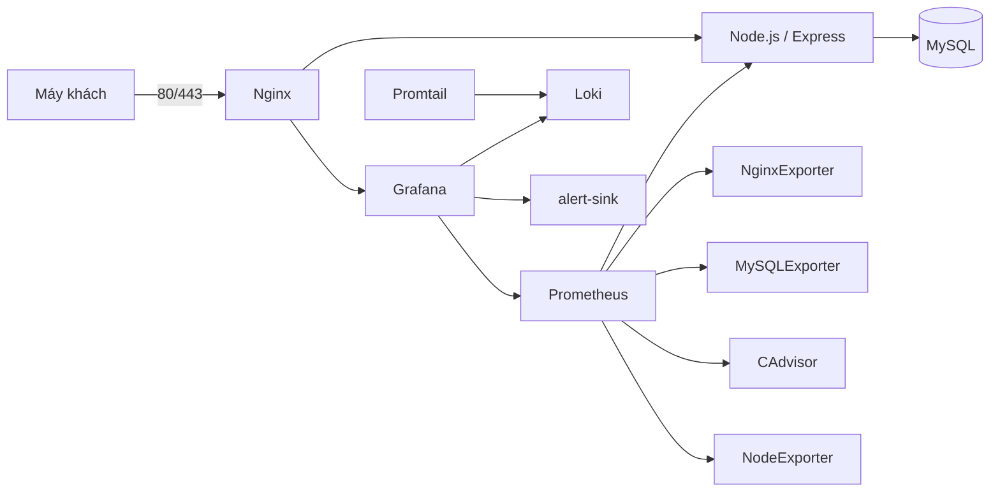

# Báo cáo triển khai hệ thống Quản lý Câu lạc bộ

> Báo cáo này phân biệt cấu hình có trong working tree với kết quả đã chạy thực tế. Docker Engine không truy cập được trong môi trường phát triển được kiểm tra; không ghi nhận bất kỳ kiểm thử end-to-end nào là thành công nếu chưa có output thật.

## Chương 1. Giới thiệu và phạm vi

Đề tài là ứng dụng web quản lý thành viên, sự kiện, đăng ký, điểm danh, thông báo, nhóm, thu/chi và audit log. Ứng dụng dùng Node.js/Express/EJS, MySQL, Nginx, Prometheus/Grafana và Loki/Promtail theo cấu hình Compose.

Các vai trò và đường dẫn được khai báo trong source:

| Vai trò | Nghiệp vụ/route tiêu biểu |
|---|---|
| Thành viên | `/member/dashboard`, `/member/profile`, `/member/events`, `/member/attendance` |
| Officer | `/officer/dashboard`, `/officer/members`, `/officer/events`, `/officer/announcements` |
| Admin | `/admin/dashboard`, `/admin/users`, `/admin/teams`, `/admin/finance`, `/admin/audit-logs` |

Đây là mô tả dựa trên routes và cấu hình trong repo, không phải kết quả smoke test.

## Chương 2. Kiến trúc và cấu hình

### 2.1 Sơ đồ



### 2.2 Các cấu hình liên quan

- Compose, network, port, volume và hardening: [docker-compose.yml](../docker-compose.yml).
- Chứng chỉ tự ký và reverse proxy: [nginx/gen-cert.sh](../nginx/gen-cert.sh), [nginx/nginx.conf](../nginx/nginx.conf).
- Scrape interval/targets: [prometheus/prometheus.yml](../prometheus/prometheus.yml).
- Provisioning Grafana và dashboards: thư mục [grafana/](../grafana/).
- Loki/Promtail: [loki/loki.yml](../loki/loki.yml), [promtail/promtail.yml](../promtail/promtail.yml).
- Ứng dụng, database grants, alert receiver và script hỗ trợ: [web/](../web/), [db/init.sql](../db/init.sql), [scripts/](../scripts/), [alert-sink/](../alert-sink/).
- Hardening và phản ứng brute-force: [hardening.md](./hardening.md), [su-co-bruteforce.md](./su-co-bruteforce.md).

Compose định nghĩa 12 service dài hạn, 3 service bootstrap một lần và 1 service kiểm tra quyền theo profile `verify`. Đây là số service khai báo trong cấu hình, **không phải số container đang chạy**; số container runtime chưa đo được.

## Chương 3. HTTPS, reverse proxy và bảo mật

Đã viết cấu hình redirect HTTP sang HTTPS, giới hạn TLS, proxy header, security headers, gzip, giới hạn request body, tắt server token, log ra stdout/stderr và endpoint status nội bộ. Compose chỉ publish Nginx; web và DB không publish cổng trực tiếp. Prometheus được cấu hình bind vào loopback để truy cập qua SSH tunnel.

Script `nginx/gen-cert.sh` tạo chứng chỉ tự ký RSA 2048, 365 ngày, CN là VM IPv4, SAN gồm VM IP, `localhost` và `127.0.0.1`. Chưa có VM IP đích nên chưa sinh hoặc kiểm tra certificate/SAN thực tế.

Các kiểm tra `nginx -t`, redirect 301, headers/TLS, status endpoint nội bộ, login qua HTTPS và khả năng truy cập cổng từ máy ngoài **chưa chạy**. Cấu hình không được coi là bằng chứng runtime.

## Chương 4. Monitoring, logging và cảnh báo

Compose pin các image Prometheus/Grafana/cAdvisor/exporter/Loki/Promtail theo tag trong [docs/phien-ban.md](./phien-ban.md). Prometheus cấu hình scrape interval 15 giây; Grafana provision dashboard containers, web/Nginx, database và logs. Promtail gắn nhãn container/service/job, không đưa IP hoặc username thành label. Alert rule và webhook `alert-sink` được cấu hình để phát hiện login thất bại.

Đã thực hiện trước đây một kiểm tra handler `alert-sink` chạy riêng trên Node cục bộ: health trả 200, webhook tổng hợp trả 202, payload JSON sai trả 400 và stdout có sự kiện alert. Đây **không** phải kiểm thử Grafana → alert-sink → Promtail → Loki.

Chưa lấy được trạng thái Prometheus targets/API, PromQL có dữ liệu, Grafana login/dashboard, truy vấn LogQL, alert Firing hoặc rate limit 429. Evidence hiện có:

- [evidence/buoc4-giamsat.txt](../evidence/buoc4-giamsat.txt)
- [evidence/buoc5-logql.txt](../evidence/buoc5-logql.txt)
- [evidence/buoc5-sucodo.txt](../evidence/buoc5-sucodo.txt)

Các tệp evidence này nằm trong workspace nhưng bị ignore, không được track bởi Git. Nội dung ghi rõ kết quả runtime chưa có.

## Chương 5. Hardening và kiểm thử

Trong cấu hình có phân tách network, DB không publish, quyền DB ứng dụng dự kiến chỉ DML trên schema, exporter dùng tài khoản riêng, và nhiều container dùng `cap_drop`, `no-new-privileges`, read-only root filesystem, tmpfs và resource limits. Các ngoại lệ (MySQL init, cAdvisor, Node Exporter, Promtail/Docker socket) được giải thích ở [docs/hardening.md](./hardening.md).

Đã chạy kiểm tra tĩnh Compose config với biến môi trường tạm, một số assertions cấu hình/network/ports, cú pháp shell/JavaScript/Python, parse JSON dashboard và `git diff --check`. Kiểm tra trước đó xác nhận Docker CLI tồn tại nhưng Docker Engine không phản hồi API. Vì vậy những mục sau **chưa xác minh**:

- Trivy CRITICAL/HIGH, Gitleaks trên lịch sử Git, quyền file `.env` trên Linux.
- Container user/security options, network inspect, listener thực tế, UFW và SSH.
- DB grants thực tế và thao tác DROP bị từ chối.
- TLS/headers/cookie, endpoint nội bộ và rate limit.
- Đăng nhập ba vai trò và workflow nghiệp vụ.
- Grafana, Loki, alert, các dashboards và LogQL.

Không thực hiện clean-state test trong thư mục riêng: Docker Engine không khả dụng; repo hiện không có commit để clone/archive; named volumes cố định có thể trùng với tài nguyên triển khai. Không xóa hoặc tạo lại volume của hệ thống hiện hữu. Cần giải quyết các điều kiện cô lập này trên VM/test host trước khi chạy test sạch.

Evidence hardening: [evidence/buoc6-hardening.txt](../evidence/buoc6-hardening.txt). Evidence Nginx: [evidence/buoc3-nginx.txt](../evidence/buoc3-nginx.txt). Tất cả evidence runtime hiện được đánh dấu chưa chạy/chưa xác minh.

## Chương 6. Phiên bản, Git và trạng thái bàn giao

### 6.1 Phiên bản

| Thành phần | Giá trị được cấu hình/quan sát | Trạng thái |
|---|---|---|
| Docker CLI | 26.1.4 | Quan sát trong môi trường phát triển Windows |
| Docker Compose | 2.27.1 | Quan sát trong môi trường phát triển Windows |
| Node.js | 22.23.2 | Quan sát trong môi trường phát triển Windows |
| npm | 10.9.8 | Quan sát trong môi trường phát triển Windows |
| Docker Engine | Không truy cập được | Runtime stack chưa thể chạy |
| Ubuntu/Engine trên VM triển khai | Không xác nhận trong lượt này | Không dùng phiên bản ghi trong tài liệu cũ làm bằng chứng mới |
| Docker images | Tag cố định xem [docs/phien-ban.md](./phien-ban.md) | Đã cấu hình; chưa xác nhận pull/run/scan |

### 6.2 Git và số liệu

- URL triển khai dự kiến: `https://<VM_IP>/`; Grafana: `https://<VM_IP>/grafana/`; Prometheus chỉ xem qua SSH tunnel tới `127.0.0.1:9091`.
- Branch đang mở: `main`; `HEAD` không tồn tại, `git rev-list --count HEAD` lỗi vì repo chưa có commit.
- `git ls-files` trả 0 file; toàn bộ dự án hiện là untracked. Không có staged files và không có hash commit để báo cáo.
- Không tạo commit, không amend và không viết lại lịch sử. Do chưa có COMMIT 1–3, điều kiện “đúng 3 commit” chưa đạt; không thể cung cấp hash/số tệp của commit.
- Working tree không sạch vì các tệp dự án/tài liệu vẫn untracked và các thay đổi của lượt này chưa commit. Điều này không thể được làm cho sạch mà không tạo commit hoặc loại bỏ thay đổi; cả hai đều không thực hiện trái yêu cầu.
- Không chạy push. Không xác nhận được GitHub owner/remote. Sau khi xác nhận URL repo `DTC245180162-club-management` và thiết lập lịch sử đúng, lệnh mẫu là:

  ```sh
  git remote add origin https://github.com/<OWNER>/DTC245180162-club-management.git
  git push -u origin main
  ```

  Nếu remote `origin` đã tồn tại, không chạy `git remote add`; kiểm tra URL bằng `git remote -v` trước khi push.
- Số container thực tế: chưa đo; không tuyên bố Compose stack đã chạy.

### 6.3 Secret và evidence

`.env`, private key/certificate, `node_modules` và `evidence/` được khai báo ignore trong `.gitignore`. Vì không có file tracked và không có commit, chưa có cơ sở xác nhận lịch sử Git đã sạch secret. Chưa chạy Gitleaks/Trivy. Trước khi push cần tạo `.env` thật chỉ trên VM, quét lại theo hướng dẫn hardening, xác nhận certificate/key không bị track, và rà soát Git history sau khi lịch sử repo được thiết lập.

Evidence đặt cục bộ trong thư mục `evidence/` và bị ignore; các đường dẫn liên quan được liệt kê ở trên. Chúng chưa được đưa vào Git và phần runtime chưa có output.

### 6.4 Danh sách ảnh đề xuất

1. Nginx config test, HTTP 301, HTTPS headers, TLS và SAN certificate.
2. Trình duyệt qua HTTPS và smoke test ba vai trò.
3. Prometheus Targets/API UP, PromQL có dữ liệu và Grafana datasource.
4. Dashboards `Club - Containers`, `Club - Web and Nginx`, `Club - Database`.
5. Grafana Explore với truy vấn LogQL đã chạy, dashboard `Club - Logs`.
6. Alert Firing, log `alert-sink`, response 429 và truy vết Nginx/app cùng khoảng thời gian.
7. Compose status, `id`/security options, network/listener, DB grants và Trivy summary.

Không chụp hoặc lưu `.env`, password, private key, cookie hay token.

## Kết luận

Các file cấu hình và tài liệu cho reverse proxy/HTTPS, monitoring, logging/alerting và hardening hiện có trong working tree. Kiểm tra tĩnh trước đây có kết quả đạt ở phạm vi đã liệt kê, cùng một kiểm tra riêng cho alert-sink. Tuy nhiên Docker Engine hiện không truy cập được, repo chưa có commit, clean-state test chưa chạy, và toàn bộ bằng chứng runtime Nginx/Prometheus/Grafana/Loki/DB/Trivy/UFW/nghiệp vụ còn thiếu. Vì vậy dự án **chưa thể được xác nhận hoàn tất triển khai hoặc đạt các yêu cầu commit**.

Các bước cần người vận hành thực hiện trên Linux VM/test host có Docker hoạt động:

1. Khởi tạo/lấy lịch sử Git đúng từ repo gốc; không import thay đổi bằng cách ghi đè lịch sử. Giải quyết các commit bắt buộc theo quy trình được chủ dự án cho phép.
2. Cấu hình `.env` mới, quyền `600`, password tài khoản seed và chứng chỉ riêng cho VM.
3. Chạy Compose, kiểm tra DB volume cũ/bootstrap, targets, Grafana/Loki/alerts, Nginx/TLS/rate limit và smoke test đầy đủ.
4. Chạy Gitleaks, Trivy, DB grants, listener/network/UFW và clean-state test với volume/port/certificate được cô lập, không xóa tài nguyên hiện hữu.
5. Thay evidence “chưa chạy” bằng output đã quan sát, rà soát secret/history và chỉ sau đó mới quyết định commit/push.
